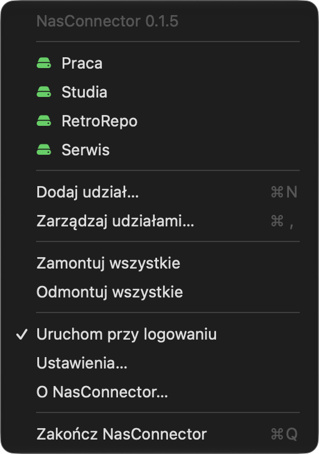
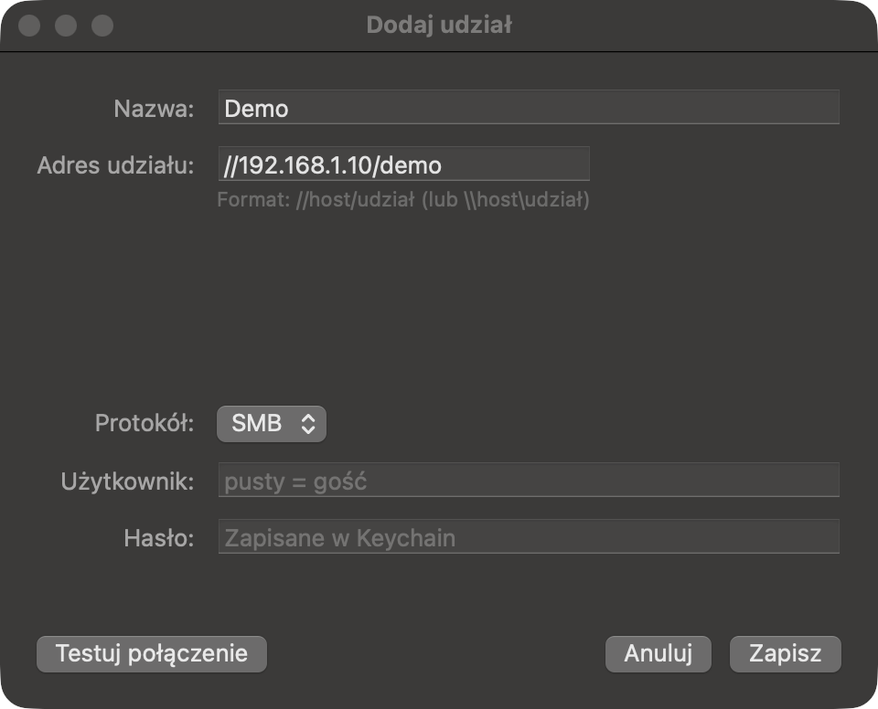
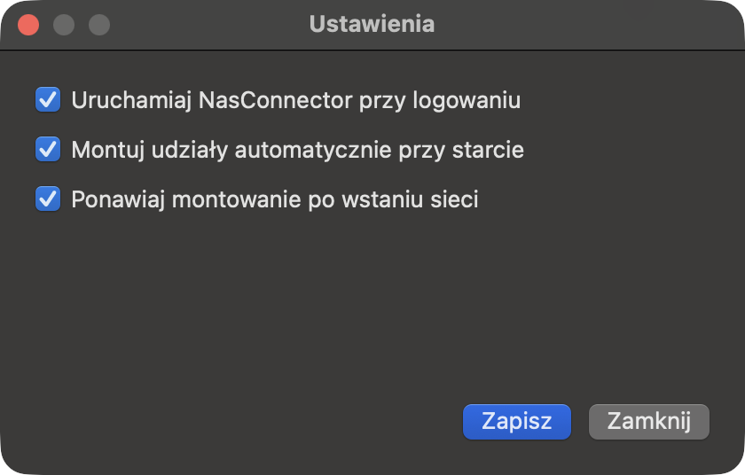

# NasConnector

[](https://github.com/retrocompxyz/nas-connector/releases/latest)
[](https://github.com/retrocompxyz/nas-connector/releases)
[](LICENSE)
[](#requirements)

A macOS menu bar app for automatically mounting SMB network shares. Add your
shares once — NasConnector mounts them for you, including at login and after the
network connection comes back.

## Screenshots

**The menu bar menu** — see your shares, mount/unmount them, and open the share editor.



**Add share** — address, credentials and a connection test before saving.



**Settings** — launch at login and app options.



## Downloads

Get the latest version from the [Releases page](https://github.com/retrocompxyz/nas-connector/releases/latest):

- **`NasConnector-<version>-universal.dmg`** — for Apple Silicon **and** Intel Macs.
- **`NasConnector-<version>-arm64.dmg`** — Apple Silicon only (smaller download).

SHA256 checksums are listed below and attached to the release.

## Requirements

- macOS 13 (Ventura) or newer.
- An SMB/CIFS share (NAS, Windows file server, macOS File Sharing, etc.).
- The **universal** build runs on both Apple Silicon and Intel.
- The **arm64** build runs on Apple Silicon only.

## Installation

### Homebrew

```bash
brew tap retrocompxyz/tap
brew install --cask nas-connector
```

### Manual

1. Download the DMG of your choice.
2. Open the image and drag `NasConnector.app` into the `/Applications` folder.
3. Launch it — an icon will appear in the menu bar.

> **First launch / Gatekeeper.** The app is not notarized by Apple, so macOS may
> block it with a warning. Either right-click the app and choose **Open**, or run:
>
> ```sh
> xattr -dr com.apple.quarantine "/Applications/NasConnector.app"
> ```

## Features

- Mount and unmount SMB shares from the menu bar.
- Manage the share list: add, edit, delete.
- Passwords stored securely in the macOS Keychain.
- Automatically mounts **all** saved shares at login and after the network
  connection is restored.
- Test the connection and credentials before saving a share.
- Support for multiple shares from the same server/IP.
- NetFS fallback for guest shares when `mount_smbfs` is not suitable.
- Menu bar only — no Dock icon.

## Why NasConnector?

macOS can reconnect network shares, but after sleep, VPN changes or Wi-Fi
switches it often fails silently. NasConnector keeps your SMB shares in one list
and remounts them at login and whenever the network comes back, with a NetFS
fallback for guest shares.

## Usage

Click the menu bar icon to:

- see the share list (click a share to mount/unmount),
- **Add share…**, **Manage shares…**, **Settings…**,
- **Mount all** / **Unmount all**,
- **Launch at login**.

### Share address format

Accepted formats include:

- `//192.168.1.10/share`
- `\\192.168.1.10\share`
- `smb://192.168.1.10/share`
- `192.168.1.10/share`
- `nas.local:4450/data`
- `[fe80::1]:445/share`

### Where shares are mounted

- Shares **with a username and password** are mounted via `/sbin/mount_smbfs`
  into `~/Mounts/<share>`.
- **Guest** shares (empty username) are mounted anonymously via NetFS into
  `/Volumes/<share>`.

> Note: macOS does not allow a regular user to create mount points in `/Volumes`,
> so shares with credentials go to `~/Mounts` (they do not appear as separate
> drives in the Finder sidebar).

## Automatic mounting at login

The app can start with the system (the **Launch at login** option, implemented
via a LaunchAgent). After launch it automatically tries to mount **all saved
shares**, and retries after the network connection is restored.

## Data and logs

- Share list: `~/Library/Application Support/NasConnector/shares.json`
- Passwords: macOS Keychain (service `com.nasconnector.app`)
- Log: `~/Library/Logs/NasConnector/nasconnector.log`

## Checksums

`NasConnector-0.1.5-universal.dmg`

```
d2987df287d6b2beaf58a18c7a1c640d95653c2947be151e037e5f3eaacd2635
```

`NasConnector-0.1.5-arm64.dmg`

```
2ebd784be789f92465a8f5b1d1143cfd46873aa0d7d6ca4e49230bb2745fe4bc
```

Verify with `shasum -a 256 <file>`.

## More from RetroComp

- **TouchBar Customizer** — per-app Touch Bar customization for MacBook Pro
  (physical Touch Bar, macOS 13+):
  [github.com/retrocompxyz/touchbar-customizer](https://github.com/retrocompxyz/touchbar-customizer)

## Author

**RetroComp** — [www.retrocomp.xyz](https://retrocomp.xyz)

## License

Licensed under the **PolyForm Noncommercial License 1.0.0** — free to use for
noncommercial purposes. Commercial use and selling are not permitted; the author
retains all commercial rights. See [LICENSE](LICENSE) for the full text.

## Notes

- The app is **not notarized** by Apple (see Installation).
- The source code is **not published**. This repository hosts the documentation
  and release binaries.
